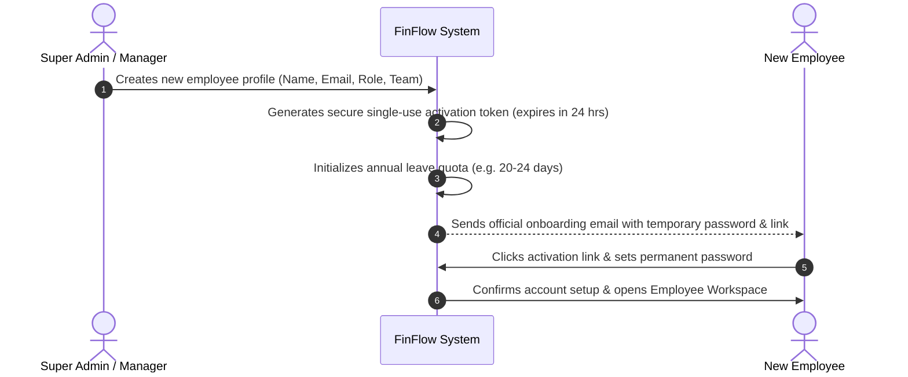
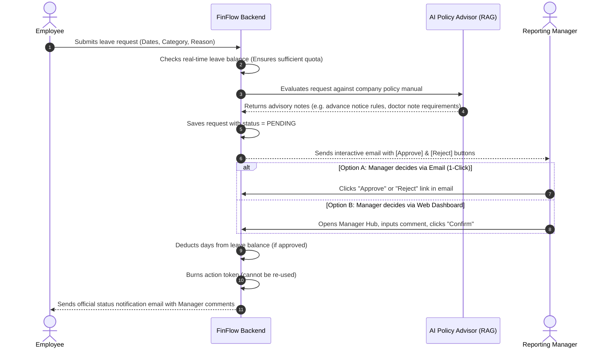
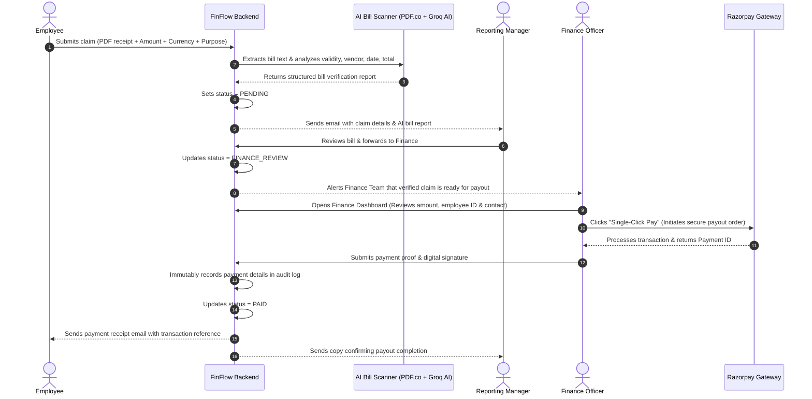
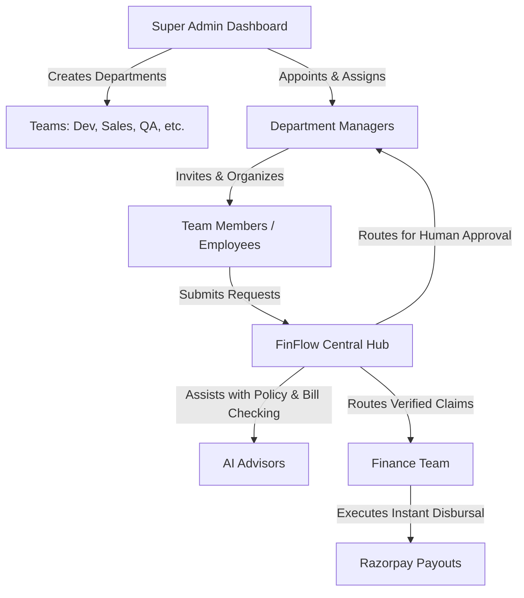

# 🌐 FinFlow — System Architecture & Complete Flow Guide
> **A Comprehensive, Non-Technical Guide to How FinFlow Works, Its Features, and End-to-End Business Workflows.**

---

## 📌 1. Executive Summary

### What is FinFlow?
**FinFlow** is an intelligent, modern workplace operations platform designed to eliminate company administrative chaos. It streamlines two of the most critical daily workflows in any organization:
1. **🌴 Leave Management (Time-off requests & quota tracking)**
2. **💵 Expense Reimbursements (Bill submission & instant employee payout)**

### The Problem It Solves
In traditional companies, requesting leave or getting money back for travel/supplies involves:
- ❌ Endless back-and-forth email threads.
- ❌ Lost paper receipts and spreadsheets that get out of sync.
- ❌ Managers having to hunt through 50-page HR PDF handbooks to know if an employee is eligible.
- ❌ Finance teams manually keying in bank transfers days or weeks after approval.

### The FinFlow Solution
FinFlow unites **Human Decision-Making** with **Smart AI Assistance**:
- **Smart AI Policy Advisor**: Automatically reads your company handbook and highlights policy rules for the manager before they approve.
- **Smart Bill Scanner**: Automatically reads receipt PDFs, extracts amounts and vendor names, and checks them for fraud or mistakes.
- **1-Click Email Approvals**: Managers can approve or reject requests directly from their inbox without having to log in to complex dashboards every time.
- **Single-Click Instant Payouts**: Finance teams can review verified bills and disburse money immediately through a trusted payment gateway (Razorpay).
- **Guaranteed Audit & Tracking**: Every penny and every leave day is transparently tracked with exact employee details (Name, ID, Contact, Date, and Digital Signature).

---

## 👥 2. Who Uses FinFlow? (The 4 Roles & Organization Hierarchy)

FinFlow is built around real-world company structures:

```
                      🏢 Organization Level
                     [ Super Administrator ]
                     (Company Owner / HR Head)
                               │
            ┌──────────────────┼──────────────────┐
            ▼                  ▼                  ▼
     👔 Dev Manager      👔 Sales Manager   👔 Testing Manager
            │                  │                  │
    ┌───────┴───────┐          │                  │
    ▼               ▼          ▼                  ▼
Senior Dev      Junior Dev  Sales Execs        QA Engineers
(Employee)      (Employee)  (Employees)        (Employees)
                               ▲
                               │
                   💳 Finance & Accounts Team
            (Dedicated role for verifying & disbursing payouts)
```

---

### The 4 Key Roles Explained Simply:

| Role | Who They Are | What They Can Do |
|---|---|---|
| **🏢 Super Administrator** | HR Director, COO, or Business Owner | • Creates the company workspace.<br>• Appoints department Managers.<br>• Creates teams (e.g., Engineering, Sales, QA).<br>• Monitors company-wide employees and activity. |
| **👔 Department Manager** | Engineering Manager, Sales Lead, etc. | • Adds and manages their own team members.<br>• Reviews incoming leave requests with AI recommendations.<br>• Reviews reimbursement bills with AI validation.<br>• Approves or forwards requests directly via email or web dashboard. |
| **👤 Employee** | Team Members, Developers, Interns | • Views real-time personal leave balances (Casual, Medical, etc.).<br>• Submits time-off requests with reasons.<br>• Submits expense bills (PDF receipts) for company reclaims.<br>• Receives instant email updates when requests are approved or paid. |
| **💳 Finance Team** | Accounts & Payroll Specialist | • Dedicated role independent of team hierarchies.<br>• Views manager-approved reimbursement claims.<br>• Sees employee bank/contact info and exact amounts.<br>• Disburses money to employee accounts with a single click via Razorpay.<br>• Maintains immutable payment audit records. |

---

## ⚡ 3. The 5 Core Superpowers of FinFlow

### 1. 🤖 Smart AI Policy Advisor (RAG Assistant)
* **What is it in plain English?**
  Imagine an experienced HR consultant who has memorized every line of your company's policy manual. The instant an employee asks for 4 days of sick leave or a medical absence, the AI instantly looks up the exact policy rules and writes a concise, 2-line advisory for the manager (e.g., *"Under Section 4.2, medical leaves over 3 days require a physical prescription upon return to office"*).
* **Important Note:** The AI **never** makes the final decision. It simply equips the manager with facts so the manager can make an informed, human decision in seconds.

### 2. 📄 Smart Bill & Receipt Scanner (AI Vision & Extraction)
* **What is it in plain English?**
  When an employee buys office supplies, client lunch, or home internet, they upload their PDF receipt. FinFlow’s document scanner reads the receipt text, identifies the vendor name, date, invoice number, and exact billed amount, and verifies it against company reclaim rules. No more squinting at blurry receipts.

### 3. 📬 1-Click Interactive Email Decisions
* **What is it in plain English?**
  Managers are busy. FinFlow doesn't force managers to open a portal, remember a password, and navigate three menus just to approve a 1-day leave. Instead, the manager receives a beautiful email with summary details, the AI's advice, and **[Approve]** / **[Reject]** buttons. One click does the job securely.

### 4. 💳 Instant Single-Click Payouts (Razorpay Integration)
* **What is it in plain English?**
  Once a manager approves a reclaim, it lands on the Finance Team's payment desk. The Finance officer sees the verified employee details, contact number, and exact amount. With **one click**, FinFlow communicates with Razorpay, securely executes the payout, generates an official payment receipt, and instantly emails the employee and manager.

### 5. 🔐 Zero-Friction Secure Onboarding
* **What is it in plain English?**
  When an admin or manager adds a new employee, FinFlow sends a secure welcome email containing temporary credentials and a single-use setup link. The employee creates their personal password, activating their account in under 60 seconds without IT intervention.

---

## 🔄 4. Complete System Flows (Step-by-Step Journeys)

---

### Flow 1: New Employee Onboarding Journey



#### How it works step-by-step:
1. **Creation**: The Super Admin or Manager enters the new hire's details and assigns them to a department.
2. **Quota Initialization**: FinFlow automatically creates the employee's annual leave balance for the year.
3. **Invitation Email**: FinFlow emails the employee a welcome message with a one-time activation link (valid for 24 hours).
4. **Password Setup**: The employee clicks the link, enters their new confidential password, and is instantly ready to use the portal.

---

### Flow 2: Leave Request & Approval Journey



#### How it works step-by-step:
1. **Submission**: The employee selects their leave type (*Casual*, *Medical*, or *Official Duty*), chooses the start and end dates, and types a short reason.
2. **Balance Validation**: FinFlow immediately checks if the employee has enough days remaining this year. If they don't, it politely blocks the request before it reaches the manager.
3. **AI Policy Assessment**: FinFlow consults the company policy document. The AI reviews whether the request meets notice guidelines, consecutive day limits, or requires doctor's notes.
4. **Manager Notification**: The manager receives an alert email with full request details and the AI advisory.
5. **Human Decision**:
   - The manager can click the **Green Approve** or **Red Reject** button directly in their email.
   - Alternatively, they can log into the FinFlow Manager Dashboard, type a custom feedback comment, and approve/reject.
6. **Balance Sync & Employee Notification**:
   - If approved: FinFlow automatically subtracts the days from the employee's annual quota.
   - The employee receives an immediate confirmation email showing their remaining leave balance and the manager's comment.

---

### Flow 3: Expense Reimbursement & Instant Payout Journey



#### How it works step-by-step:
1. **Upload & Submission**: The employee uploads an invoice or bill (e.g., broadband internet, travel ticket, client lunch) and enters the claimed amount.
2. **Automated AI Scan**: 
   - FinFlow converts the PDF into text.
   - Groq AI inspects the bill, extracting the vendor, date, category, and billed total, comparing it to the employee's claim.
3. **Manager Review**: The manager sees the bill and the AI analysis report. Once satisfied that the expense was for legitimate business, the manager clicks **"Verify & Forward to Finance"**.
4. **Finance Disbursement Desk**:
   - The verified claim appears on the Finance Team's desk.
   - The Finance officer sees the employee's name, employee ID, contact number, and the exact verified amount.
5. **Instant Payment**:
   - The Finance officer clicks **"Pay Now"**.
   - FinFlow connects to **Razorpay** to execute the payment order.
6. **Immutable Record & Receipt**:
   - Once payment is confirmed, FinFlow writes a permanent audit record into the database that cannot be tampered with.
   - The claim is marked as **PAID**.
   - An official branded payment receipt is automatically emailed to both the employee and their manager.

---

### Flow 4: Management & Team Governance Journey



#### How it works step-by-step:
1. **Flexible Team Building**: A company can have separate teams (e.g., Frontend Team, QA Team, Marketing Team), each led by their own manager.
2. **Decentralized Management**: Managers don't need IT help to manage their teams—they can invite new developers, interns, or associates directly.
3. **Account Safety**: If an employee leaves the company, admins or managers can deactivate their account with a single switch, instantly revoking access while preserving all historical financial records.

---

## 📊 5. Comparison: Traditional Process vs. FinFlow

| Feature | Traditional Way | The FinFlow Way |
|---|---|---|
| **Leave Quota Tracking** | Messy Excel sheets updated manually at month-end | Real-time, automatic balance deduction on approval |
| **Policy Checking** | Manager has to search HR manuals or ask HR over Slack | Instant AI advisory generated in under 2 seconds |
| **Manager Approvals** | Long email chains or logging into heavy legacy portals | 1-Click approval directly from an interactive email |
| **Receipt Scanning** | Blurry phone photos reviewed manually by finance | AI automatically extracts vendor, date, and billed amounts |
| **Expense Reimbursement** | Added to next month's payroll after weeks of waiting | Instant single-click direct payout via Razorpay |
| **Audit & Transparency** | Missing receipts and undocumented approvals | Permanent digital records with timestamps, tokens, & payment IDs |

---

## 🛡️ 6. Security, Trust & Human-in-the-Loop Safeguards

FinFlow was built with strict safety principles:

1. **Human Always Decides**: The AI is strictly an **advisor**. It cannot approve or reject leaves or money claims on its own. Only authorized human managers and finance officers make decisions.
2. **Single-Use Action Tokens**: When an approval link is sent in an email, it contains a unique cryptographic key. Once clicked, it instantly expires. It cannot be forwarded to someone else or clicked twice.
3. **Role-Based Access Control**:
   - An employee can only view their own requests and personal leave balance.
   - A manager can only review members of their own team.
   - Only the designated Finance team can trigger payment disbursements.
4. **Complete Audit Trail**: Every transaction stores the exact employee ID, phone number, timestamp, paying officer, and Razorpay transaction reference for tax and regulatory compliance.

---

## 📖 7. Plain-English Glossary

* **RAG (Retrieval-Augmented Generation)**: An AI technology that reads your specific company documents (like your HR Leave Policy) and answers questions accurately based *only* on that handbook, without making up false facts.
* **Token**: A temporary, secure digital key used in emails so a manager can approve an action with one click without typing their username and password.
* **Razorpay**: A secure, certified payment gateway used by businesses to transfer money directly into bank accounts or UPI instantly.
* **OCR (Optical Character Recognition)**: Software that reads text from scanned PDF receipts and bills just like human eyes would.
* **Leave Balance**: The official number of personal, sick, or casual leave days an employee is allowed to take during a calendar year.

---

## 🎯 8. Summary

FinFlow transforms company operations from slow, fragmented paper-and-email workflows into a **fast, transparent, and joyful experience**. Employees receive their approved leaves and reimbursement money quickly; managers save hours of reading policies; and business owners gain complete visibility and peace of mind over organization spending and attendance.
